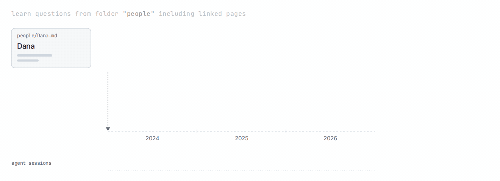

<div align="center">

# 🧬 Enzyme

[](https://discord.gg/nhvsqtKjQd)
[](LICENSE)
[](https://github.com/byenzyme/enzyme/releases/latest)
[](https://github.com/byenzyme/enzyme/releases)

</div>

Enzyme compiles your notes and other knowledge sources into a local index that:

1. Uses temporally grounded context sampling that captures the contextual use of tags and wikilinks, or natural accumulation in folders (i.e. pseudo-[Zettelkasten](https://zettelkasten.de/introduction/))
2. With this context, it "dreams" questions in the background (called **catalysts**) and embeds them. At query time, each question finds its nearest docs, so it avoid needing to "dream" full summaries. (see note)
3. Keeps refreshing, but separates new doc ingestion (local, fast) from catalyst evolution (cheap, periodic)

The catalysts help orient the agent to the wiki. Enzyme saves up to 50% tokens vs. plain agentic search with grep.

<picture>
  <source media="(prefers-color-scheme: dark)" srcset="docs/assets/enzyme-loop-dark.gif">
  
</picture>

*(Note: your system may already generate lots of memories in different buckets; Enzyme catalysts help thread them together)*

## Get started

Open your Markdown notes folder with your agent and paste this prompt.

```text
Set up Enzyme for the Markdown notes folder I have open. If you cannot identify it, ask me for its path.

Install Enzyme if needed using https://raw.githubusercontent.com/byenzyme/enzyme/main/install.sh, and install the instructions for this agent. Read and follow the installed enzyme-workspace-setup skill.

Use it to suggest settings from my notes and prepare search. Show me what you propose to include or exclude, and let me correct it before building the local search index.

Then answer one useful question using my notes, with links to the sources, and suggest a question I can ask next. Keep my existing notes in place and unchanged. Ask separately before any cleanup, model download, or recurring task.
```

After setup, keep working with your agent as usual. The new guidance tells your agent how to use Enzyme and when to refresh it.

Prefer to install it yourself first? Run this, then paste the same prompt:

```bash
curl -fsSL https://raw.githubusercontent.com/byenzyme/enzyme/main/install.sh | bash
cd /path/to/your/notes
enzyme install claude # or: codex, hermes, openclaw
```

## What it's for

Enzyme was built for knowledge bases that grow quickly:

* Obsidian vaults that accumulate dated notes in a few folders
* Meeting notes and AI-native, Markdown CRM setups
* Agent memory written as Markdown

At setup time, it proposes a `.enzyme` program by reading your wiki and existing agent instructions, like:

```
profile relationships {
  seek "what matters between people"
  notice ["meaningful exchanges", "shared interests", "unfinished conversations"]
}

workspace "notes" {
  source markdown "notes" { path "~/notes" }

  question budget 40
  sample across time
  favor recent periods

  learn questions from folder "people"
    including linked pages
    about relationships
  learn questions from folder "meetings" about operational
  learn questions from tags ["startup", "design"] about decisions
  learn questions from folder "inbox"

  project questions into "~/notes/Readwise"

  // Guidance compiled for your agent, not an enforced hook.
  when asked {
    "Use grep for names, titles, and exact phrases."
    retrieve passages through learned questions
    answer with sources
  }
}
```

And you can give feedback to modify the program.

Enzyme helps most when a question spans many notes written over time: context for a decision on a project, or a broader theme arising from conversations with one person. It's designed to support knowledge captures that might be later be important, even if they don't serve a current task. Enzyme is focused on doing one thing well: **giving agents the tools to make ideas compound**. And it ships with a set of `profiles` designed around a personal knowledge base
were refined over [2 years of personal use](https://joshpham.com/kit/how-i-use-enzyme):

| Read...                  | For...                                          | Profile               |
|--------------------------|-------------------------------------------------|-----------------------|
| Project notes            | what's stuck and what keeps blocking            | `operational`         |
| Decision records         | why a choice won, what would change it          | `decision_trace`      |
| Saved articles           | connections to what you're already working on   | `resonance_trace`     |
| Journals                 | what keeps returning across entries             | `reflective`          |
| People notes             | what matters in these relationships             | `relational`          |
| Feedback / activity logs | what works for you, under what constraints      | `preference_evidence` |
| *(default)*              | costs, assumptions, live tensions               | `tension_trace`       |

## Reference

### Setup without an agent

```bash
enzyme compile -v
# Review the .enzyme settings file at the path printed by compile.
enzyme init --quiet
enzyme doctor
enzyme catalyze "a question about your notes"
```

`compile` proposes settings and saves them; `init` builds the local index from
them; `doctor` reports what was indexed and any problems.

### Other sources

For Apple Notes, a preset builds a named `workspace` program from your Notes
database. Review the saved `.enzyme` program before running `init`:

```bash
enzyme --workspace apple-notes compile --preset apple-notes \
  "$HOME/Library/Group Containers/group.com.apple.notes/NoteStore.sqlite"
enzyme --workspace apple-notes init
```

For Are.na, use `enzyme --workspace <name> compile --preset arena <channel-url>`
and then `enzyme --workspace <name> init`. Run `refresh` with the
same `--workspace` name to pick up later changes (`--collection` is an accepted
alias).

### Retrieval commands

`enzyme petri` shows what Enzyme found worth asking about. In a terminal it renders a tree; piped, it emits JSON.

```bash
enzyme petri -n 2
```

```text
Petri
├─ #working-with-others · tag · active · 11 mentions
│  └─ catalysts
│     ├─ Why did every auth change still route through me after I kept promising to write it down?
│     ├─ Why did the third auth extraction attempt stall when nobody wanted to own the session model?
│     ├─ Which reasons for handing the session model to Maya had I stopped believing by then?
│     ├─ Did extraction stay paused once Maya's team owned the session model?
│     └─ …
└─ #system-design · tag · active · 10 mentions
   └─ catalysts
      ├─ Why did I pick a monolith with inner module boundaries over splitting services yet?
      ├─ Did I ever settle who owns the session model once auth moves out?
      ├─ Which part of auth extraction kept adding layers instead of removing one?
      ├─ Does my view that independence means who can change what still hold?
      └─ …
```

An agent reads this map first, then searches. `enzyme catalyze` ranks notes by wording and meaning together, and each result carries the catalyst that best connects it to the query:

```bash
enzyme catalyze -n 3 "why we keep rewriting the auth layer" \
  | jq '{search_strategy, results: [.results[] | {file_path, similarity, via_catalyst_text, content}]}'
```

```json
{
  "search_strategy": "hybrid",
  "results": [
    {
      "file_path": "retros/2025-q3-platform-retro.md",
      "similarity": 0.817,
      "via_catalyst_text": "Why did I keep scoping auth extraction as a two-week project, and what kept stalling it?",
      "content": "# Q3 platform retro\n#system-design #working-with-others\n\nScoped auth extraction as a two-week project for the third time. The real blocker was not the token service; nobody wanted to own the session model. Every proposal added a layer instead of removing one. Action: decide ownership before touching code again."
    },
    {
      "file_path": "journal/2025-05-12.md",
      "similarity": 0.693,
      "via_catalyst_text": "Why did every auth change still route through me after I kept promising to write it down?",
      "content": "#working-with-others\n\nReviewed eleven PRs today and wrote none. Every auth change still routes through me because I wrote the session code and nobody else wants to touch it. I keep saying I will write it down so someone else can own it. I have not."
    },
    {
      "file_path": "1on1s/2026-01-maya.md",
      "similarity": 0.579,
      "via_catalyst_text": "What keeps pulling me back to rewriting when Maya's smaller version already worked?",
      "content": "# 1:1 with Maya\n#working-with-others\n\nMaya replaced the token refresh path with something half the size of mine. She asked me twice and then stopped asking, which is the point. I want to do this with billing before I start rewriting it myself."
    }
  ]
}
```

### Message archives (_experimental_)

Enzyme indexes SQLite tables alongside Markdown — iMessage, WhatsApp, Mail, or any table of dated rows.

Declare a `source sqlite` inside a named `workspace` program, then run `init`
and periodic `refresh`. The [SQLite source setup skill](https://github.com/byenzyme/enzyme/blob/main/skills/enzyme-sqlite-source/SKILL.md)
shows the source declaration and source-scoped readings.

None of these is a special case. A `handle_id` column is repeated person values across dated rows, the same way `[[links]]` are repeated person values across dated notes. Both collapse to entity occurrences with effective dates, and nothing downstream knows which one it came from: the same profiles, budgets, and catalysts apply to a message thread and a folder of meeting notes.

A source names columns by the role they play rather than by the app they came from:

| Role     | Means                                           |
|----------|-------------------------------------------------|
| `id`     | the row's identity                              |
| `who`    | participants; scalar, JSON array, or delimited  |
| `when`   | the row's timestamp                             |
| `what`   | the text to read                                |
| `where`  | the container the row belongs to (optional)     |
| `weight` | numeric significance per occurrence (optional)  |

### API keys

Enzyme needs an API key only for catalyst generation and for Markdown `enzyme compile`'s selection step. Source preset compilation does not call a model. By default `enzyme init` uses Enzyme's hosted bootstrap and ignores inherited `OPENAI_*` variables so it does not spend your personal key. Credential resolution is explicit key → configured local model → anonymous brokered free config, with no additional configuration.

The first configured vault on a machine initializes without login. Refresh, publishing, account credits, and additional vaults require `enzyme login`.

To bring your own OpenAI-compatible key, pass `--llm env` (alias `--use-env-llm`), which reads only `OPENAI_API_KEY` plus optional `OPENAI_BASE_URL` and `OPENAI_MODEL`. `init` and `refresh` also take `--llm local` (the installed local model; fails if none is installed), `--llm hosted`, and `--llm none` (index, embed, and select without generating catalysts). Without `--llm` and without any hosted or env key, catalyst generation is skipped and indexing, embedding, and local search still work.

A model served on your own machine (LM Studio, Ollama, a llama.cpp server) works through `--llm env` with `OPENAI_BASE_URL` pointing at it; `OPENAI_API_KEY` must be non-empty even if the server ignores it. Enzyme treats localhost addresses like its built-in 135M model: a compact prompt, at most 10 excerpts per entity, one call per entity, and a 512-token output cap. That includes a proxy on localhost in front of a remote provider. For a larger model, set `ENZYME_LOCAL_MODEL=0` to send it the same prompts and job splitting as hosted generation (`ENZYME_LOCAL_MODEL=1` does the reverse for a small fine-tune hosted elsewhere). That path runs up to 8 calls at once and each request must finish within 120 seconds, so on a slower model set `ENZYME_LLM_CONCURRENCY` to what the server handles and lower `ENZYME_CATALYST_MAX_QUESTIONS_PER_CALL` to keep each call short.

Markdown `enzyme compile` is an explicit OpenRouter Decisions operation. It reuses the hosted lease from `enzyme login` and the free-config broker; an explicit `OPENAI_API_KEY` with `OPENAI_BASE_URL=https://openrouter.ai/api/v1` takes precedence. Catalyst generation uses `OPENAI_MODEL`; Decisions uses `ENZYME_JEV_MODEL` (default `typesafe/jev-1.13`).

## License

Enzyme is licensed under the [Apache License 2.0](LICENSE).
